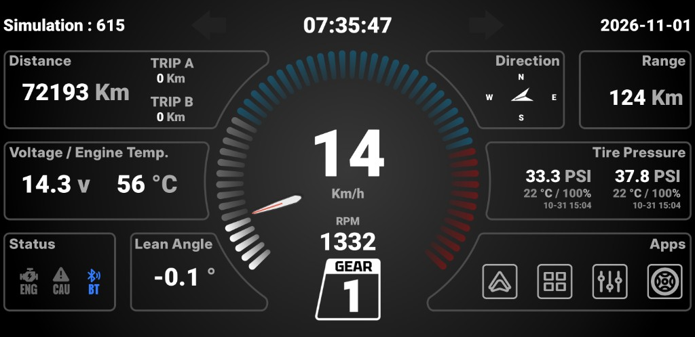
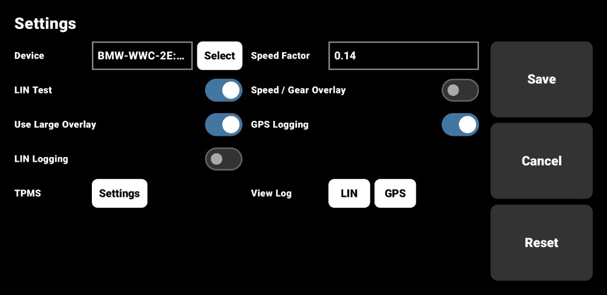
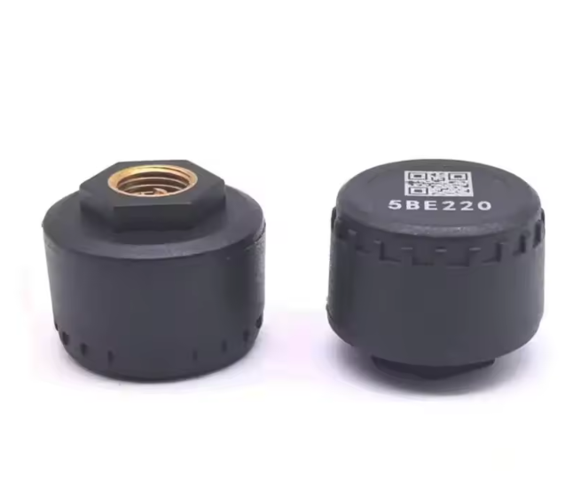
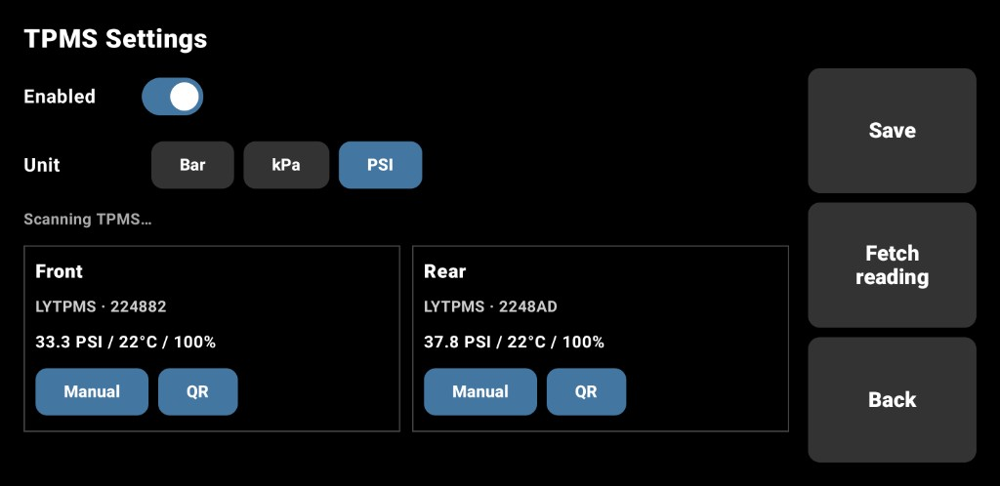

# BMW Motorrad Cluster — Android 애플리케이션

[English](README.md)

ESP32에서 BLE로 받은 차량 정보를 표시하는 **스마트폰 클러스터** 앱입니다. 속도 / RPM / 기어 / 전압 등을 보여 주며, **[Open Headunit](https://github.com/andreknieriem/open-headunit)**(Android Auto 리시버, 패키지 `com.andrerinas.headunitrevived`)과 **연동해 함께 동작**하도록 설계되었습니다. 가로(reverseLandscape) 홈·런처로도 쓸 수 있습니다.

| 저장소 | 역할 |
|---|---|
| [bmw-motorrad-cluster-linbus](https://github.com/kendrickkim/bmw-motorrad-cluster-linbus) | LIN 디코드 문서 |
| [bmw-motorrad-cluster-esp32](https://github.com/kendrickkim/bmw-motorrad-cluster-esp32) | ESP32 LIN → BLE / HID 펌웨어 |
| **이 저장소** (`bmw-motorrad-cluster-application`) | Android 클러스터 UI + BLE 클라이언트 |



## 기능

- Compose 기반 **가로 클러스터 UI**
- 포그라운드 **`BleService`**: `BMW-WWC-*` 연결, LIN 원본 프레임 해석, UI 브로드캐스트
- 위치 저장되는 **오버레이** (속도/기어 등)
- **휠 RPM → 속도** 환산 계수 설정 (SharedPreferences)
- Wonder Wheel 경로용 **`VirtualKeyService`** (접근성)
- **HOME / 런처**로 등록 가능 (`SplashActivity`)
- 페어링 BLE 장치명·주소 설정
- **Open Headunit** (`com.andrerinas.headunitrevived`)과 연동 — 바이크에서 Android Auto와 함께 동작
- **TPMS** (설정 → TPMS): 외부 BLE 타이어 공기압 센서 연동 (`TpmsService`)



## 사용 TPMS 장치



설정 화면에서 **Settings → TPMS**로 진입해 센서 스캔·ID 바인딩, Front/Rear 압력·온도를 확인한다. ESP32 클러스터 BLE(`BleService`)와는 **별도** 서비스(`TpmsService`)이다.



프로토콜 상세: [docs/tpms-ble-analysis.md](docs/tpms-ble-analysis.md)

## 요구 사항

| 항목 | 설명 |
|---|---|
| Android | **minSdk 29**, target / compileSdk **35** |
| 언어 | Kotlin, Java 17 |
| UI | Jetpack Compose + Material 3 |
| DI | Hilt |
| BLE | ESP32 `BMW-WWC-…` 광고 + (선택) TPMS Advertise (`FBB0`) |
| 권한 | Bluetooth, 위치(레거시 스캔), 알림, 오버레이, 접근성 등 |

## 빌드

Gradle 루트는 저장소 최상위가 아니라 **`src/`** 입니다.

```bash
cd bmw-motorrad-cluster-application/src
./gradlew :app:assembleDebug
# Windows:
gradlew.bat :app:assembleDebug
```

- Application ID: `com.dooderge.bmw.motorrad.cluster`
- Android Studio에서는 `src/` 폴더를 열어 주세요.

## 최초 설정

1. ESP32를 켜 `BMW-WWC-…`가 광고되게 합니다.
2. 앱 설치 후 Bluetooth / 알림 / 오버레이 권한을 허용합니다.
3. 설정에서 ESP32 장치명·주소를 저장합니다.
4. (선택) **접근성 → BMW Motorrad Cluster** 활성화.
5. (선택) 기본 홈 앱으로 지정.
6. 표시 속도가 다르면 **휠 RPM → 속도** 계수를 조정합니다 (코드 기본값 `0.14`).
7. (선택) **Settings → TPMS**에서 TPMS 센서를 스캔하고 Front/Rear ID를 바인딩합니다.

## BLE LIN 프레임 파싱

- Service: `0000180a-0000-1000-8000-00805f9b34fb`
- Characteristic: `00002a01-0000-1000-8000-00805f9b34fb`

실차에서 ESP32는 notify마다 원본 프레임 7바이트를 보냅니다. `LinFrame.kt`가 `lin_analysis` 기준으로 해석합니다. 12바이트 이상이면 벤치용 기존 car-status 패킷으로 처리합니다.

| Offset | 필드 |
|:------:|------|
| 0 | Message ID |
| 1 | Data-0 |
| 2 | Data-1 |
| 3 | Data-2 |
| 4 | Data-3 |
| 5 | Data-4 |
| 6 | Data-5 |

| ID | `CarStatus`에 넣는 값 |
|:--:|------------------------|
| `0x14` | 핸들 비트(혼, 비상등, ABS, ESA, 크루즈, 하이빔, Trip, Info), Wonder Wheel in/out와 회전 방향 |
| `0x20` | 이그니션, 속도, 주행가능거리, 조도 |
| `0x2B` | Data-1이 `0x25`일 때 적산거리 |
| `0xE2` | RPM, 기어, 스로틀, 냉각수 온도, ASC, 오일 |
| `0xE9` | 평균 속도, 보조 속도, 전압 raw (`Data-3`, 화면은 `/ 10` V), 연료 고장, 일반 고장 |

ID `0x20` 속도는 `lin_analysis`의 고정 계수를 씁니다.

```text
speed_kmh ≈ rear_wheel_rpm × 0.14
```

## 관련 문서

- LIN 분석: [LIN_ANALYSIS.md](https://github.com/kendrickkim/bmw-motorrad-cluster-linbus/blob/main/lin_analysis/LIN_ANALYSIS.md)
- 펌웨어: [bmw-motorrad-cluster-esp32](https://github.com/kendrickkim/bmw-motorrad-cluster-esp32)
- TPMS 분석: [docs/tpms-ble-analysis.md](docs/tpms-ble-analysis.md)

## 참고

- 권장 구성: 이 클러스터 UI + **Open Headunit**. 주행 중에는 안전이 우선이며 현지 법규를 지키세요.
- 오버레이·접근성 서비스는 사용자가 명시적으로 허용해야 합니다.
